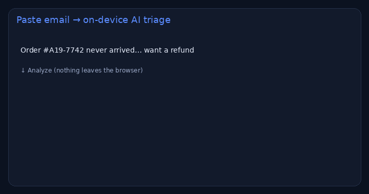

# Inbox AI — classify & extract (no API key)

> **For non-technical clients — start here**
>
> **What it does:** Reads a customer email/ticket, tags it (support, quote, complaint…), extracts order id / amount / email, and drafts a reply — **inside the browser**.
>
> **Try it in 1 click:** [**live demo**](https://nyyoautomation.github.io/nyyoautomation/demos/inbox-ai/) → click a sample → **Analyze**.
>
> **Business benefit:** faster first answers, fewer missed angry customers. From about **$300** (CRM wiring from **$500**).

**Live:** https://nyyoautomation.github.io/nyyoautomation/demos/inbox-ai/

Nothing is uploaded. Production builds can plug OpenAI/Claude when you provide a key.

## Hire me
[LaborX](https://laborx.com/freelancers/users/id475124) · [Profile](https://github.com/nyyoautomation)
