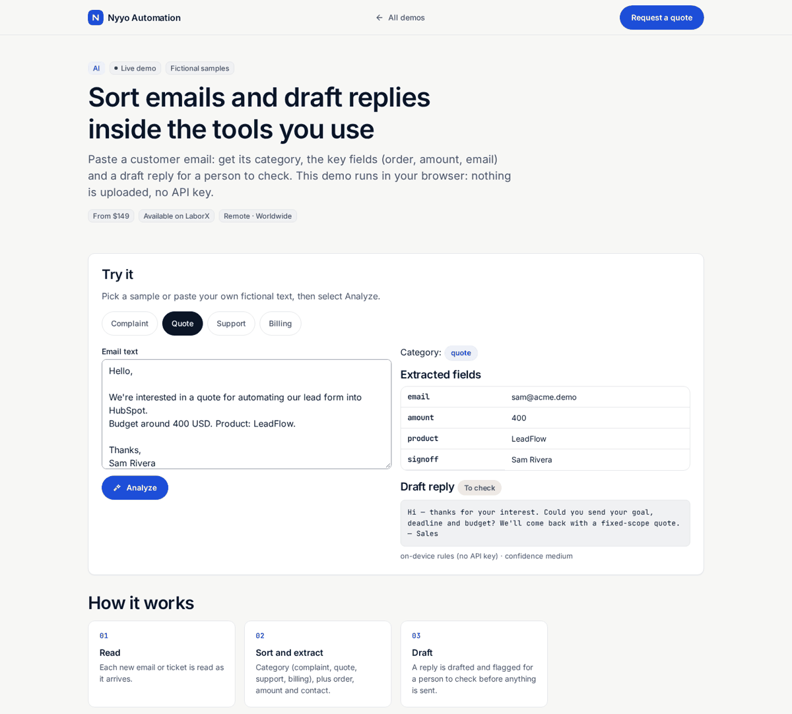

# Inbox AI — classify & extract (no API key)

> **For non-technical clients — start here**
>
> **What it does:** Reads a customer email/ticket, tags it (support, quote, complaint…), extracts order id / amount / email, and drafts a reply — **inside the browser**.
>
> **Try it in 1 click:** [**live demo**](https://nyyoautomation.github.io/nyyoautomation/demos/inbox-ai/) → click a sample → **Analyze**.
>
> **Packages:** Starter **$149** · Standard **$399** · Pro **$849**. Install kit included with all three: [nyyo-inbox-ai](https://github.com/nyyoautomation/nyyo-inbox-ai).

**Live:** https://nyyoautomation.github.io/nyyoautomation/demos/inbox-ai/

Nothing is uploaded. Production builds can use OpenAI or Claude with your own API key.

**Run locally:** `python3 -m http.server 8000` from the repository root, then open http://localhost:8000/demos/inbox-ai/.

## How to order

Available on LaborX · [Request a quote](https://laborx.com/freelancers/users/id475124)

Questions? Ask in your order chat.

