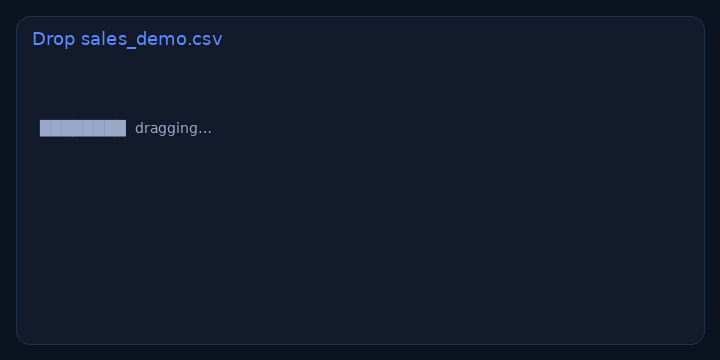

# Instant CSV → KPI dashboard

> **For non-technical clients — start here**
>
> **What it does:** You drop an Excel/CSV export; the page builds totals and charts in a few seconds. Your file never leaves the browser.
>
> **Try it in 1 click:** [**live demo**](https://nyyoautomation.github.io/nyyoautomation/demos/instant-dashboard/) → **Load sample**.
>
> **Business benefit:** weekly reporting without rebuilding pivots. Pricing on quote.

**Live:** https://nyyoautomation.github.io/nyyoautomation/demos/instant-dashboard/

## How to order

Available on LaborX · [Profile & packages](https://github.com/nyyoautomation)

Questions? Ask in your order chat.

