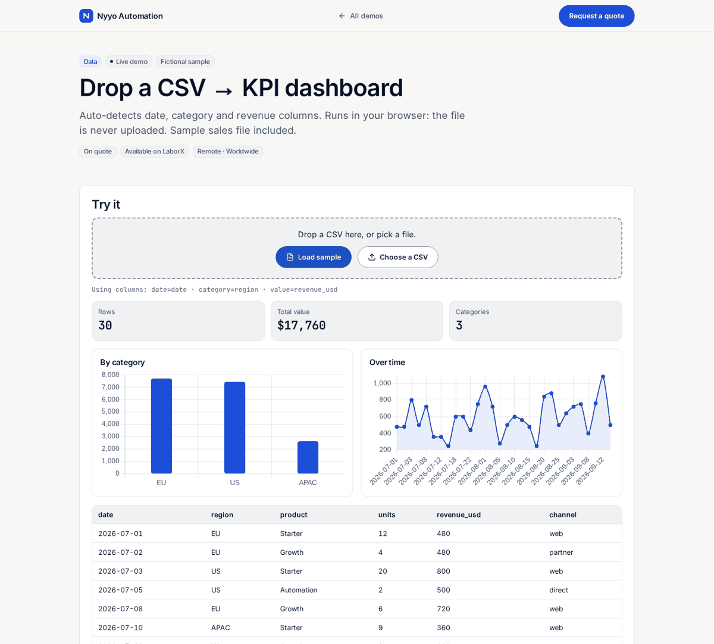

# Instant CSV → KPI dashboard

> **For non-technical clients — start here**
>
> **What it does:** You drop an Excel/CSV export; the page builds totals and charts. Your file never leaves the browser.
>
> **Try it in 1 click:** [**live demo**](https://nyyoautomation.github.io/nyyoautomation/demos/instant-dashboard/) → **Load sample**.
>
> **Pricing:** on quote.

**Live:** https://nyyoautomation.github.io/nyyoautomation/demos/instant-dashboard/

**Run locally:** `python3 -m http.server 8000` from the repository root, then open http://localhost:8000/demos/instant-dashboard/.

## How to order

Available on LaborX · [Request a quote](https://laborx.com/freelancers/users/id475124)

Questions? Ask in your order chat.

