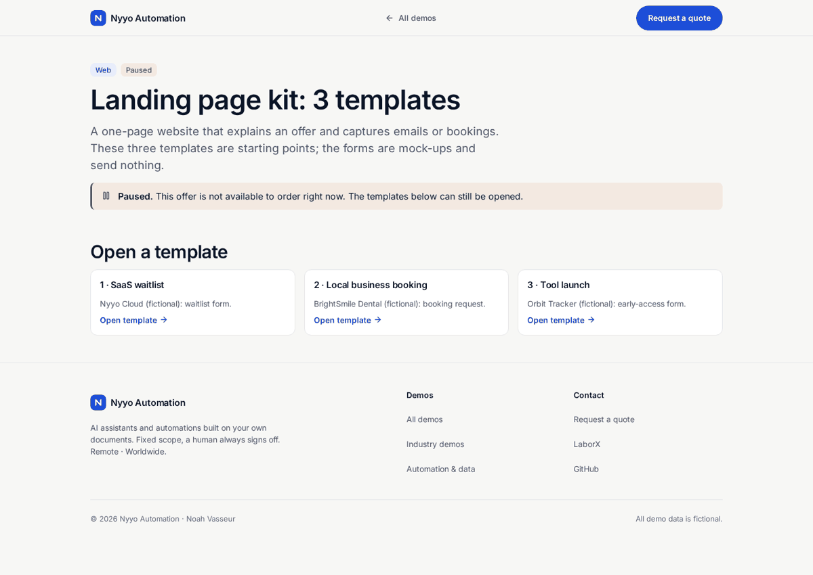

# Landing pages kit (SaaS · local · tool launch)

> **Status: paused.** This offer is not available to order right now. The templates can still be opened.

> **For non-technical clients — start here**
>
> **What it does:** Three ready landing-page templates you can open, customize, and publish.
>
> **Try it in 1 click:** [**kit home**](https://nyyoautomation.github.io/nyyoautomation/demos/landing-kit/).

**Live:** https://nyyoautomation.github.io/nyyoautomation/demos/landing-kit/

**Run locally:** `python3 -m http.server 8000` from the repository root, then open http://localhost:8000/demos/landing-kit/.

## Questions

[Request a quote on LaborX](https://laborx.com/freelancers/users/id475124)

