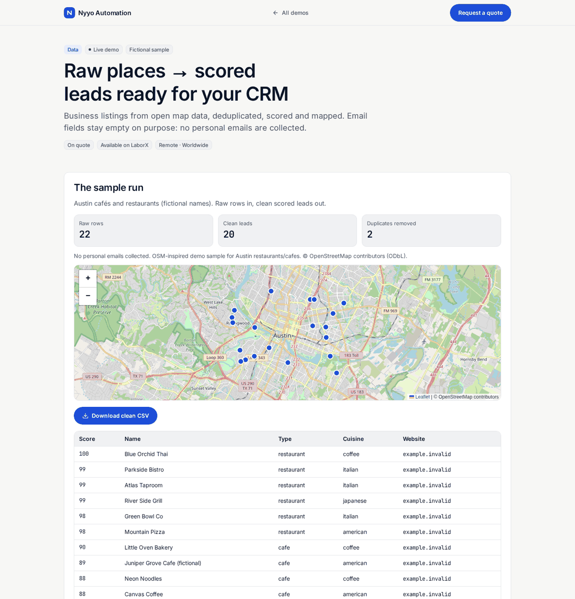

# B2B lead pipeline (OpenStreetMap)

> **For non-technical clients — start here**
>
> **What it does:** Turns open map business listings into a **deduped, scored** CSV for your CRM — with a map preview.
>
> **Try it in 1 click:** [**live demo**](https://nyyoautomation.github.io/nyyoautomation/demos/lead-pipeline/).
>
> **Business benefit:** SDRs work a short ranked list, not a dirty dump. Pricing on quote.
>
> **Ethics:** this demo does **not** collect personal emails.

**Live:** https://nyyoautomation.github.io/nyyoautomation/demos/lead-pipeline/  
Data © OpenStreetMap contributors (ODbL).

**Run locally:** `python3 -m http.server 8000` from the repository root, then open http://localhost:8000/demos/lead-pipeline/ (opening `index.html` directly does not load the data).

## How to order

Available on LaborX · [Request a quote](https://laborx.com/freelancers/users/id475124)

Questions? Ask in your order chat.

