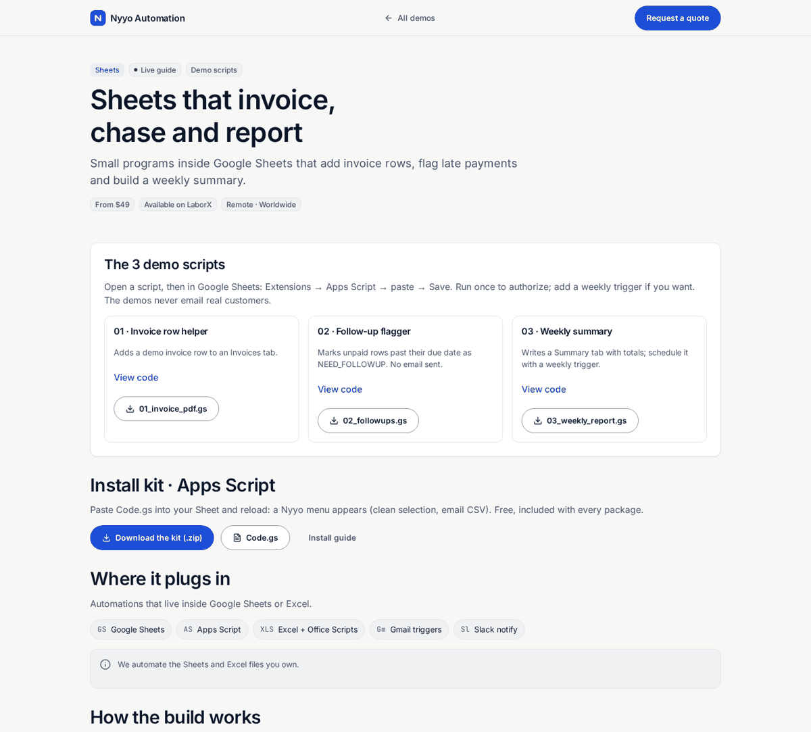

# Google Sheets automation pack (Apps Script)

> **For non-technical clients — start here**
>
> **What it does:** Three ready Apps Script snippets — invoices, follow-ups, weekly report.
>
> **Try it:** open [**the guide**](https://nyyoautomation.github.io/nyyoautomation/demos/sheets-automations/) and copy a `.gs` file into your Sheet.
>
> **Pricing:** from **$49** · full pack on quote.

**Live:** https://nyyoautomation.github.io/nyyoautomation/demos/sheets-automations/

**Run locally:** `python3 -m http.server 8000` from the repository root, then open http://localhost:8000/demos/sheets-automations/ (needed for the "View code" panels).

## How to order

Available on LaborX · [Request a quote](https://laborx.com/freelancers/users/id475124)

Questions? Ask in your order chat.

