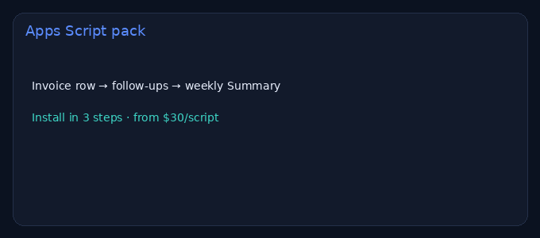

# Google Sheets automation pack (Apps Script)

> **For non-technical clients — start here**
>
> **What it does:** Three ready Apps Script snippets — invoices, follow-ups, weekly report.
>
> **Try it:** open [**the guide**](https://cdn.jsdelivr.net/gh/nyyoautomation/nyyoautomation@main/demos/sheets-automations/index.html) and copy a `.gs` file into your Sheet.
>
> **Business benefit:** Sheets work while you sleep. From **$30**/script · **$200–400** full pack.

**Live:** https://cdn.jsdelivr.net/gh/nyyoautomation/nyyoautomation@main/demos/sheets-automations/index.html

## Hire me
[LaborX](https://laborx.com/freelancers/users/id475124)
