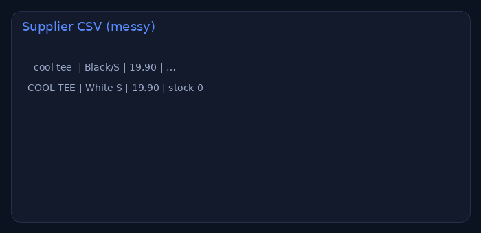

# Supplier CSV → Shopify import

> **For non-technical clients — start here**
>
> **What it does:** Cleans a supplier spreadsheet into Shopify’s official product CSV (handles, variants, stock, SEO).
>
> **Try it in 1 click:** [**live demo**](https://nyyoautomation.github.io/nyyoautomation/demos/shopify-importer/) → Load sample → Download.
>
> **Business benefit:** catalog updates in minutes.

**Live:** https://nyyoautomation.github.io/nyyoautomation/demos/shopify-importer/

## How to order

Available on LaborX · [Profile & packages](https://github.com/nyyoautomation)

Questions? Ask in your order chat.

