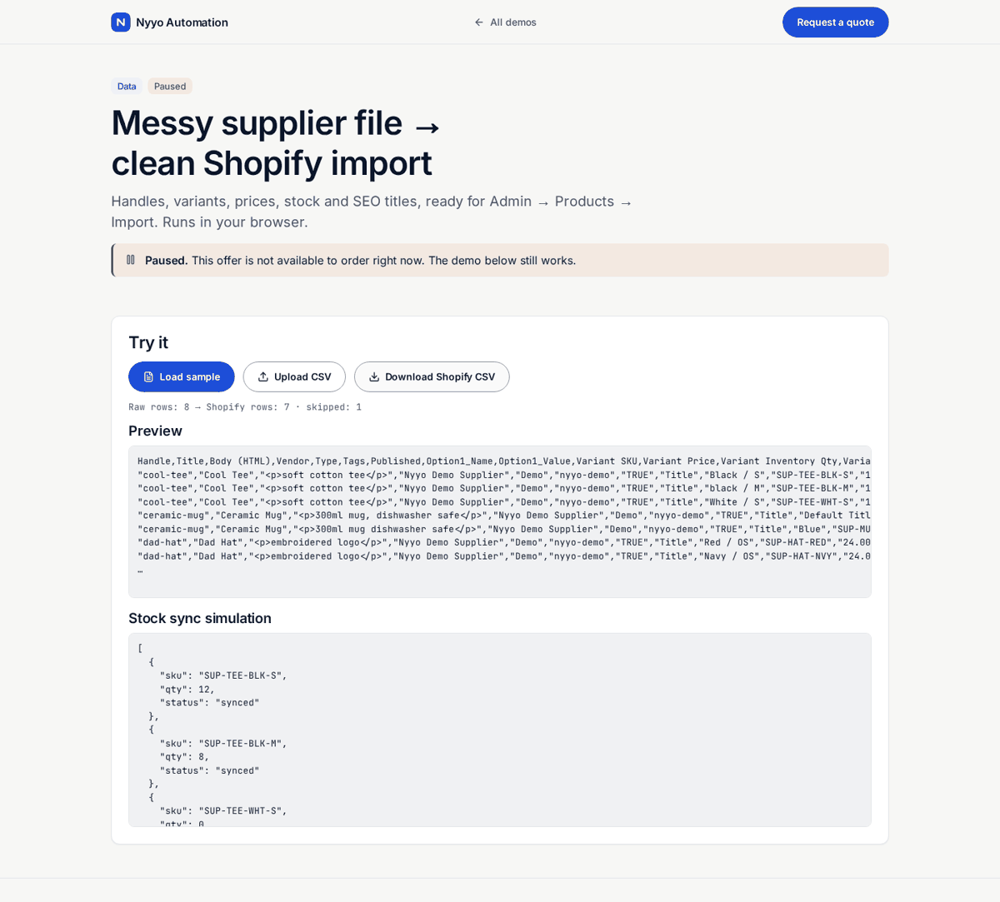

# Supplier CSV → Shopify import

> **Status: paused.** This offer is not available to order right now. The demo still works.

> **For non-technical clients — start here**
>
> **What it does:** Cleans a supplier spreadsheet into Shopify’s official product CSV (handles, variants, stock, SEO).
>
> **Try it in 1 click:** [**live demo**](https://nyyoautomation.github.io/nyyoautomation/demos/shopify-importer/) → Load sample → Download.

**Live:** https://nyyoautomation.github.io/nyyoautomation/demos/shopify-importer/

**Run locally:** `python3 -m http.server 8000` from the repository root, then open http://localhost:8000/demos/shopify-importer/.

## Questions

[Request a quote on LaborX](https://laborx.com/freelancers/users/id475124)

