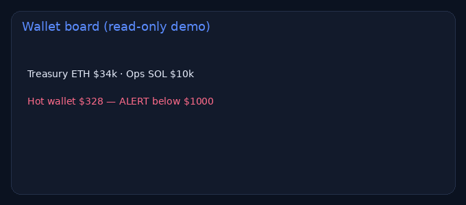

# Wallet tracker (read-only)

> **For non-technical clients — start here**
>
> **What it does:** Shows balances and alerts for public wallets on one page. Read-only — never asks for a seed.
>
> **Try it in 1 click:** [**live demo**](https://nyyoautomation.github.io/nyyoautomation/demos/wallet-tracker/).
>
> **Business benefit:** spot empty gas tanks early.

**Live:** https://nyyoautomation.github.io/nyyoautomation/demos/wallet-tracker/

## How to order

Available on LaborX · [Profile & packages](https://github.com/nyyoautomation)

Questions? Ask in your order chat.

