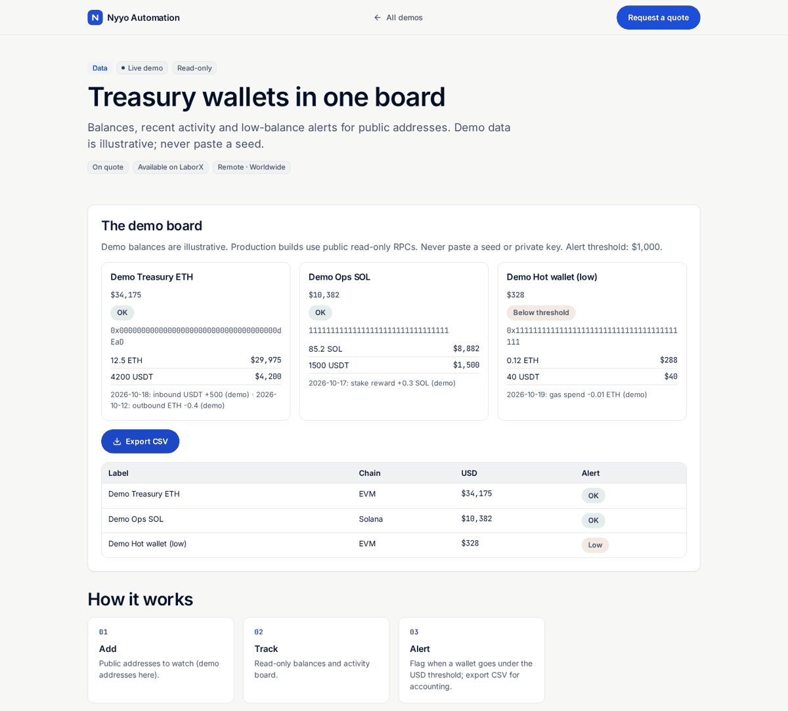

# Wallet tracker (read-only)

> **For non-technical clients — start here**
>
> **What it does:** Shows balances and alerts for public wallets on one page. Read-only — never asks for a seed.
>
> **Try it in 1 click:** [**live demo**](https://nyyoautomation.github.io/nyyoautomation/demos/wallet-tracker/).
>
> **Pricing:** on quote.

**Live:** https://nyyoautomation.github.io/nyyoautomation/demos/wallet-tracker/

**Run locally:** `python3 -m http.server 8000` from the repository root, then open http://localhost:8000/demos/wallet-tracker/ (opening `index.html` directly does not load the data).

## How to order

Available on LaborX · [Request a quote](https://laborx.com/freelancers/users/id475124)

Questions? Ask in your order chat.

